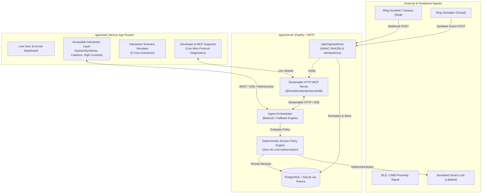

# KindDoor System Architecture

## 1. Executive Summary & Product Vision
**KindDoor** ("The front door that adapts to you") is an accessibility-first home entry intelligence system designed for the Amazon Developer Hackathon 2026. KindDoor bridges the gap between intelligent entry hardware, conversational agent interfaces, and diverse physical/cognitive human needs.

It targets:
- **Alexa+ Track**: Self-hosted Streamable HTTP Model Context Protocol (MCP) server with an integrated client simulation.
- **Ring Track**: Production-aligned Ring webhook and event ingestion pipeline with cryptographic signature validation, event deduplication, and a matched Ring Simulator.
- **AWS Builder Mini-Challenge**: Direct runtime integration with Amazon Bedrock (Converse API with dynamic Tool Use) alongside a deterministic fallback engine.

---

## 2. High-Level Architecture Diagram

---

## 3. Core Subsystems

### 3.1. Deterministic Security & Access Policy Engine
**Critical Security Invariant:** *AI models (Bedrock, LLMs, or agent heuristics) NEVER directly command the physical or simulated lock.*
- All entry requests generate an authorization evaluation request containing:
  1. Resident Profile ID & configured entry preferences.
  2. Verified Credential Signal (e.g., Cryptographic Mobile BLE Handshake, Resident PIN/Token, Geofence + Intent Token).
  3. Proximity / Arrival context from Ring/Sensors.
  4. Current Lock State.
- If all required factors in the resident-defined policy pass, the policy engine generates an authorized `LockCommandToken` and dispatches `execute_authorized_entry`.
- If any condition is missing or unverified, entry is denied with a structured explanation code (`CREDENTIAL_MISSING`, `LOCK_JAMMED`, `POLICY_DISABLED`).

### 3.2. Model Context Protocol (MCP) Server
- Implemented using the official TypeScript `@modelcontextprotocol/sdk`.
- Exposes Streamable HTTP endpoint (`/mcp`) supporting protocol versions `2025-11-25` and `2024-11-05`.
- Implements 9 explicit tools:
  1. `get_door_context`: Returns current doorbell state, visitor presence, optical sensor metadata.
  2. `get_resident_preferences`: Returns accessibility profiles (blind, deaf, patient, standard).
  3. `get_visitor_context`: Retrieves known visitor profile or returns unverified status.
  4. `record_visit_purpose`: Stores visitor stated purpose temporarily.
  5. `create_temporary_visit`: Creates time-bounded visit record for deliveries / temporary guests.
  6. `request_resident_decision`: Pushes structured A/B options to resident interface.
  7. `evaluate_entry_authorization`: Pure deterministic evaluation of entry conditions.
  8. `get_lock_status`: Queries current verified state from lock adapter.
  9. `execute_authorized_entry`: Invokes lock adapter ONLY upon valid policy authorization token.
  10. `enroll_regular_visitor`: Consent-gated enrollment requiring explicit resident confirmation.

### 3.3. Amazon Bedrock Orchestrator
- Uses `@aws-sdk/client-bedrock-runtime` Converse API (`converse` / `converseStream`).
- Automatically formats tool definitions from MCP tool schemas into Bedrock Converse tool specifications.
- Handles iterative tool calling loop with bounded recursion (max 5 steps).
- When AWS credentials or models are unreachable, automatically shifts to the **Deterministic Conversational Engine** without breaking simulation flow.

### 3.4. Ring Ingestion & Normalization Adapter
- Aligned with Amazon Ring Developer Portal specifications and `ring-api-helloworld`.
- Validates Ring Webhook signatures (`X-Ring-Signature` / HMAC-SHA256 with timestamp window check).
- Memory-bounded LRU Cache for idempotency keys to drop duplicate webhook retries.
- Normalizes events into domain `DoorEvent` (`MOTION`, `DING`, `INTERACTION_START`, `INTERACTION_END`).

### 3.5. Accessible Resident Experience Layer
- **Blind / Low-Vision**: Web Speech API (`SpeechSynthesis`) with controlled pitch/rate, keyboard-first navigation (ARIA live regions, focus trapping, global hotkeys `[Space]` repeat, `[1]` / `[2]` select).
- **Deaf / Hard-of-Hearing**: High-visibility banner, real-time live captions, color-coded status badges, vibration API triggers (where supported).
- **Older Adults / Simplified Interaction**: Minimal cognitive load, 2-choice max decisions (Yes/No, Admit/Decline), conversational patience with natural repetition.

---

## 4. Technology Stack & Workspace Matrix

| Layer | Technology | Justification |
| :--- | :--- | :--- |
| **Monorepo** | pnpm workspaces | Clean package boundaries, shared types, single lockfile |
| **Web Frontend** | Next.js 15, Tailwind CSS, Lucide | Responsive, accessible, SSR/Client hybrid, WCAG 2.2 AA target |
| **Backend Server** | Fastify, TypeScript | Low latency, schema validation, HTTP streaming for MCP |
| **MCP SDK** | `@modelcontextprotocol/sdk` | Official spec compliance for Alexa+ developer tools |
| **AI Orchestration** | AWS SDK Bedrock Runtime v3 | Genuine Amazon Bedrock Converse API with tool use |
| **Database & ORM**| Prisma ORM (SQLite / PostgreSQL) | Strongly-typed schema, migrations, audit trail |
| **Validation** | Zod | Runtime type safety across API, MCP, and Webhook boundaries |
