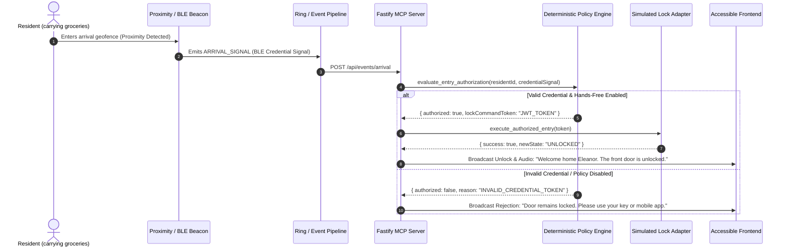

# KindDoor End-to-End Workflows & User Scenarios

This document details the exact sequence of events, MCP tool calls, accessibility adaptations, and deterministic policy evaluations for all five core hackathon scenarios.

---

## Scenario A: Resident Arrives with Hands Full

### Objective
Demonstrate hands-free, credential-verified entry for a resident returning with groceries, with immediate accessible vocal & visual confirmation, and negative authorization handling.

### Sequence Flow

---

## Scenario B: Blind or Low-Vision Resident

### Objective
A Ring doorbell event occurs. KindDoor communicates visitor presence, context, and stated purpose through browser speech synthesis, visible high-contrast text, keyboard-accessible shortcuts, and replayability.

### Flow
1. **Event**: Ding or Motion event received at the door.
2. **Context Retrieval**: Agent calls `get_door_context` and `get_visitor_context`.
3. **Audio Announcement**: System announces via Web Speech API:
   *"Someone is at your front door. It appears to be your neighbor Maya. She says she brought the gardening tools you borrowed. Press Space to hear again, or press 1 to speak, 2 to decline."*
4. **Resident Input**: Resident can press `[Space]` to replay, or `[1]` / `[2]` or voice command to respond.
5. **No Visual Barrier**: Every interactive element is tagged with ARIA live regions (`aria-live="polite"` / `role="status"`).

---

## Scenario C: Deaf or Hard-of-Hearing Resident

### Objective
Deliver an equivalent, zero-auditory dependent visual-first experience with high-contrast banners, live transcription, visitor cards, and clear visual action buttons.

### Flow
1. **Event**: Ring Ding event arrives.
2. **Visual Alert**: Prominent screen flash / color-accented alert banner (`ring-amber-500` flashing indicator).
3. **Transcription & Context**: Real-time caption box displays:
   - **Visitor Status**: `Unenrolled Visitor`
   - **Stated Purpose**: *"Delivery for Eleanor — Package from Amazon"*
4. **Action Palette**: Clear buttons with icons:
   - `[Admit / Unlock]` (If permitted)
   - `[Request Delivery Leave at Door]`
   - `[Decline]`
   - `[Repeat / Enlarge Text]`

---

## Scenario D: Older Resident Needs Patient Assistance

### Objective
Provide calm, unhurried natural language explanations, simplified binary choices, and strict adherence to the safety rule: *Silence never counts as consent*.

### Flow
1. **Event**: Visitor Mark arrives.
2. **Resident Asks**: *"Who is at the door?"*
3. **KindDoor**: *"Someone who appears to be Mark is here. He says he has come to visit you. Would you like to speak to him?"*
4. **Resident**: *"I don't understand."*
5. **KindDoor (Patience Engine)**: Recognizes confusion, strips technical jargon, presents 2 simple options:
   *"Mark may be here to visit. Would you like me to let you speak to him, or would you rather not?"*
6. **Resident Timeout/Silence**: If no response is given within 45s, KindDoor gently states: *"I have not opened the door. Mark has been asked to leave a message."* (Zero auto-unlock on silence).

---

## Scenario E: Unfamiliar Visitor & Consent-Gated Enrollment

### Objective
Handle an unknown visitor stating *"I'm John. I'm a family friend."* Verify the system distinguishes claims from verified records, stores temporary metadata, and forbids permanent profile creation without explicit resident consent.

### Flow
1. **Visitor Speaks**: *"I'm John, a friend of your son."*
2. **Agent Inquiry**: Calls `get_visitor_context(name: "John")` -> Returns `{ isEnrolled: false }`.
3. **Temporary Retention**: Agent calls `record_visit_purpose(statedName: "John", isDelivery: false)`. Visit record set with 30-day auto-purge deadline.
4. **Resident Dialogue**: KindDoor informs resident: *"A visitor at the door claims to be John, a family friend. We do not have a verified profile for John."*
5. **Enrollment Gate**: Only if the resident clicks or speaks *"Enroll John as a regular visitor"*, the system executes `enroll_regular_visitor(residentConsentGiven: true)`.
